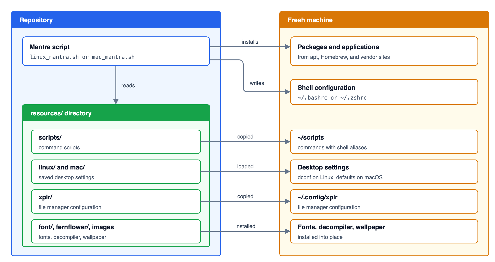
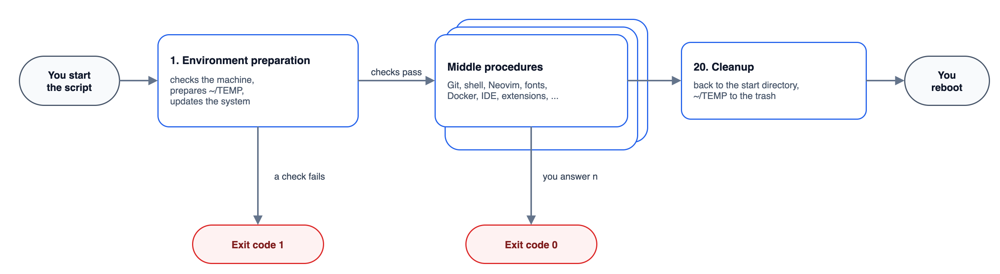
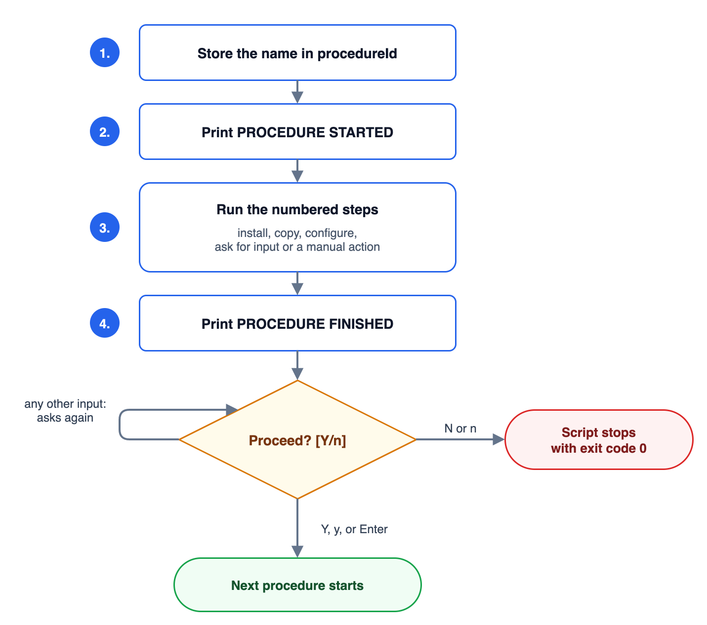
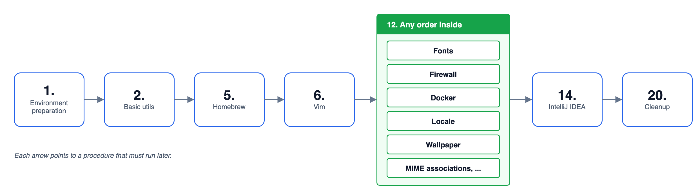
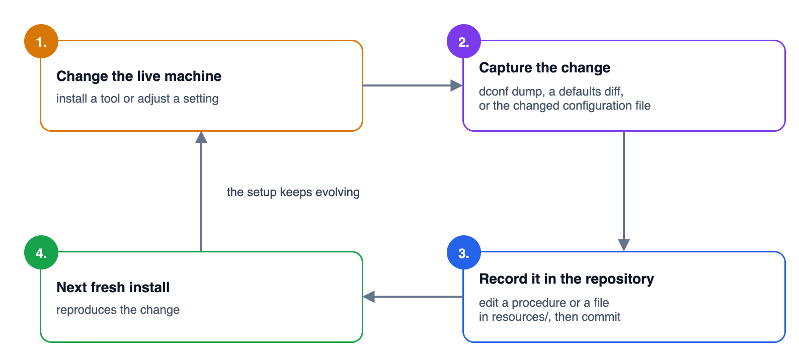

[.text-justify]
= Linux Mantra
:reproducible:
:doctype: article
:author: Herman Ciechanowiec
:email: herman@ciechanowiec.eu
:chapter-signifier:
:sectnums:
:sectnumlevels: 5
:sectanchors:
:toc: left
:toclevels: 5
:icons: font
:linkcss:
:sourcedir: {docdir}
:stylesdir: https://www.ciechanowiec.eu/linux_mantra/
:stylesheet: adoc-css-style.css
:source-highlighter: rouge
:rouge-css: style
:!table-caption:
:!figure-caption:
:!example-caption:

ifdef::backend-html5[]
ifndef::env-github[]
++++
<link href="https://www.ciechanowiec.eu/linux_mantra/adoc-docinfo.css" rel="stylesheet">

++++
endif::[]
endif::[]

Linux Mantra sets up the author's personal development workstation on a freshly installed operating system. Two interactive Bash scripts, `linux_mantra.sh` for Ubuntu 26.04 and `mac_mantra.sh` for macOS 27, install the author's tools and apply the author's settings and files. Each script runs as a sequence of numbered procedures and waits for confirmation after each one.

[[purpose-and-scope]]
== Purpose and Scope

. A freshly installed operating system lacks the tools, settings, and files that a developer gathers over years of work. Linux Mantra records them as code, so a reinstalled machine reaches the same state when one script runs on it. The setup is personal: anyone can run it, but the result fits the author's way of working. For other developers, Linux Mantra is an example of how to build a similar tool.
. The scripts do four kinds of work:
.. installing packages and applications, for example `curl`, Neovim, Docker, and Terraform,
.. writing configuration, for example shell aliases in `~/.bashrc`,
.. applying desktop and system settings, for example GNOME settings and the firewall,
.. copying scripts and assets, for example fonts and the wallpaper.

[[repository-structure]]
== Repository Structure

. A [[mantra-script]]_mantra script_ is a Bash file that drives the whole setup of one operating system, from the first command to the last. Every step is a shell command written out in full in the script.
. The [[resources-directory]]_resources directory_ is the directory `resources` beside the xref:#mantra-script[mantra scripts] that holds the files they copy, load, or run, such as command scripts, saved desktop settings, and fonts. A mantra script looks for this directory next to its own file, so the two must stay side by side.
. The diagram shows where the content of the repository ends up on the machine:
+
[[repository-structure-diagram]]
.Parts of the repository and their destinations on the machine

[[run-sequence]]
== Run Sequence

A [[procedure]]_procedure_ is a block of a xref:#mantra-script[mantra script] that sets up one tool or one area of the system, such as Git or Docker. A run executes the procedures from top to bottom. The first procedure, environment preparation, checks the machine, and the last, cleanup, removes temporary files:

[[run-sequence-diagram]]
.Run of `linux_mantra.sh` from start to reboot

[[environment-preparation]]
=== Environment Preparation

The first xref:#procedure[procedure] checks that the machine runs the operating system and release the xref:#mantra-script[mantra script] was written for, recreates the temporary directory `~/TEMP`, and updates the system packages. A failed check stops the script with exit code 1. Because the procedure deletes `~/TEMP` with all its content, the repository must not lie inside that directory.

[[confirmation-prompts]]
=== Confirmation Prompts

. The pause after each xref:#procedure[procedure] lets the user check its result before the next procedure builds on it. A command that fails inside a procedure doesn't stop the xref:#mantra-script[mantra script], so the user finds a failure by reading the output before confirming.
. Procedures follow a common skeleton. The Git xref:#procedure[procedure] of `linux_mantra.sh` shows it in shortened form:
+
[source,bash]
----
# Excerpt: the banner, steps 2 and 4, and the email prompt are omitted.
# The three functions called here are defined at the top of the script.
procedureId="git"
informAboutProcedureStart

echo "1. Installing git..."
sudo apt install git -y

echo "3. Setting up a global git committer..."
echo "Enter global git committer name (first name and surname, eg. John Doe):"
read -r committerName
git config --global user.name "${committerName}"

informAboutProcedureEnd
promptOnContinuation
----
. The xref:#procedure[procedure] announces its start, runs numbered steps that can ask for input, announces its end, and asks `Proceed? [Y/n]`. The diagram shows the possible answers:
+
[[procedure-anatomy-diagram]]
.Steps of one procedure and the answers to its prompt
 then starts the next procedure on Y, y, or Enter, stops the script with exit code 0 on N or n, and asks again on any other input."]
. A stopped run has no resume point. Running the xref:#mantra-script[mantra script] again starts from the first xref:#procedure[procedure], and the procedures aren't designed to run twice.
. Some settings belong to graphical applications whose menus change between versions, so the xref:#procedure[procedure] doesn't set them. It prints instructions and waits until the user completes them and presses Enter.

[[priority-numbers]]
=== Priority Numbers

The [[priority-number]]_priority number_ is the number in the banner of a xref:#procedure[procedure] that states its place in the order of dependencies, such as 4 in `4. GIT`. By convention, a procedure runs after every procedure with a lower number, and procedures that share a number may run in any order among themselves. The numbers tell a person who edits a xref:#mantra-script[mantra script] where a procedure may move. For example, the Vim procedure, number 6, installs Neovim with `brew`, which the Homebrew procedure, number 5, installs:

[[priority-numbers-diagram]]
.Selected procedures of `linux_mantra.sh` ordered by priority number

[[cleanup]]
=== Cleanup

The last xref:#procedure[procedure], number 20, returns to the directory where the run started and moves `~/TEMP` to the trash. A reboot then activates changes such as new GNOME extensions.

[[linux-and-macos]]
== Linux and macOS Variants

Both xref:#mantra-script[mantra scripts] follow the run sequence described in the section xref:#run-sequence[]. They differ where the operating systems differ:

[cols="1,2,2",options="header"]
|===
|Aspect |`linux_mantra.sh` |`mac_mantra.sh`
|Shell configuration file |`~/.bashrc` |`~/.zshrc`
|Desktop settings |`dconf load` of a saved settings file |`defaults` commands and saved preference files
|===

[[first-run]]
== First Run on a Fresh Machine

. Install Ubuntu 26.04 or macOS 27 from scratch. On Ubuntu, enable disk encryption, which the xref:#mantra-script[mantra script] requires.
. Download this repository from GitHub as a `.zip` archive, unpack it outside `~/TEMP`, and start the mantra script for your system from a terminal in the unpacked directory:
+
[source,bash]
----
bash linux_mantra.sh
----
. Run the xref:#mantra-script[mantra script] as your normal user, without `sudo`. The script calls `sudo` itself where needed, and under `sudo` your files can end up in the root user's home directory.
. Answer the questions, confirm each xref:#procedure[procedure], and reboot after cleanup.

[[reproducible-setup]]
== Reproducible Setup Over Time

A workstation keeps changing after its first setup: tools become obsolete, new versions appear, and new settings replace old ones. Linux Mantra stays useful only when each change on the live machine also reaches the repository. The diagram shows the cycle that records each change:

[[maintenance-loop-diagram]]
.Cycle that records changes of the live machine in the repository

[[about-the-document]]
== About the Document

. The source text of this document is written in the https://asciidoc.org[AsciiDoc^] markup language.
. The source text of this document must follow the link:README-guideline-writing.adoc[Writing Guideline for Utilitarian Non-Fiction^]. The guideline is stored beside the source text in the same Git repository.
. The https://github.com/ciechanowiec/adocent[`adocent`^] application lints, converts, and watches the source text of this document.
. *Usage of https://github.com/ciechanowiec/adocent[`adocent`^]*
+
`adocent usage` prints the complete https://github.com/ciechanowiec/adocent[`adocent`^] manual and JSON reference catalogs, producing a large output. Don't run it during routine writing. Use it only when command help and lint diagnostics don't resolve a specific usage problem. Save the output to a temporary file and read only the relevant sections. AI agents must not load the full output into their context.
. *Linting*
+
To lint the source text of this document, run this command from the directory containing the source text:
+
[source,bash,subs="attributes+"]
----
adocent lint "{docname}{docfilesuffix}"
----
. *Converting*
+
To convert this document to HTML, PDF, and DOCX, run this command from the directory containing the source text:
+
[source,bash,subs="attributes+"]
----
adocent convert "{docname}{docfilesuffix}" --to html --to pdf --to docx
----
. *Watching*
+
To open a live HTML preview of this document, run this command from the directory containing the source text:
+
[source,bash,subs="attributes+"]
----
adocent watch "{docname}{docfilesuffix}"
----

ifdef::backend-html5[]
ifndef::env-github[]
++++

++++
endif::[]
endif::[]
